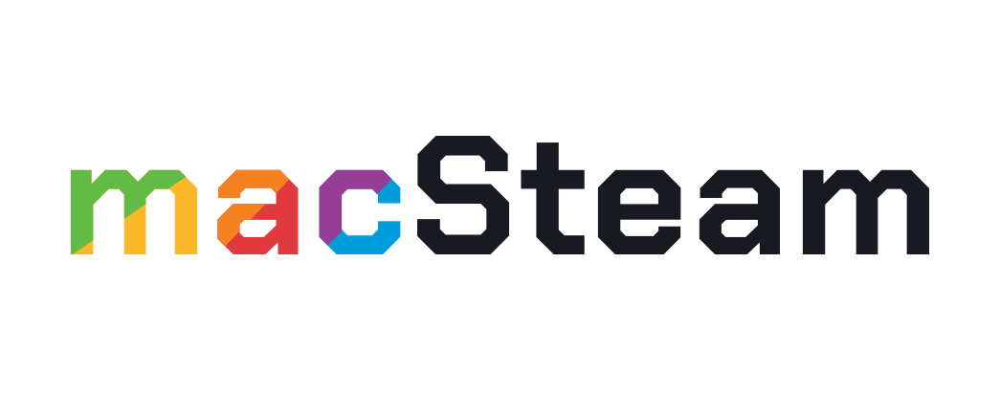

# SteamDriver

<p align="center">
  <picture>
    <source media="(prefers-color-scheme: dark)" srcset="app/Resources/WordmarkDark.png">
    
  </picture>
</p>

**Windows games from the macOS Steam app on Apple Silicon, with lower input latency, a Wine of
its own for every game, and Apple's D3DMetal for DirectX 12.**

SteamDriver is the project; **macSteam** is its app. The app installs **SteamDriver**, a Steam
Play compatibility tool you choose per game in macOS Steam, and manages everything around it.
SteamDriver works together with [NotProton](https://github.com/NotProtonNot/NotProton), which
turns on Steam Play in the macOS Steam app. It's a fork of
[MacVolvo](https://github.com/haeli05/MacVolvo), which is built on
[Recall](https://github.com/AsherJN/recall).

> **Status: first release, 1.0, coming soon** at
> [Releases](https://github.com/Seglats/macSteam/releases). Download it there (see
> [Installing](#installing)); macSteam updates itself from there. Expect rough edges.

**Questions, help or feedback:** join the [Discord](https://discord.gg/Y2pJE5g2Sw).

## What it does

### SteamDriver: a Wine for every game

**SteamDriver** is CrossOver 26.3's Wine, built from source with our own patches. macSteam adds it
to macOS Steam. In a game's **Properties › Compatibility**, turn on "Force the use of a specific
Steam Play compatibility tool" and choose **SteamDriver**. It needs NotProton (for Steam Play and
its Steam bridge) but not CrossOver.

- **Direct3D 12** through Apple's D3DMetal, from your own copy of Apple's Game Porting Toolkit;
  **Direct3D 11** through DXMT.
- **Lower input latency**: Recall's Mac driver with raw mouse input (up to 2,000 reads a
  second) and the **High-precision** mouse, which reads the mouse directly.
- **Profiles**: Global DX11, Global DX12 and per-game profiles with renderer settings and
  **key combo overrides** ([docs/PROFILES.md](docs/PROFILES.md)).
- **MetalFX upscaling (DLSS)**: a game's DLSS option runs on Apple's MetalFX
  ([docs/UPSCALING.md](docs/UPSCALING.md)).
- **Install a Windows game**: drop a game's installer (GOG's offline installers and others) on
  macSteam and it becomes a game in your Steam library, with its Steam artwork, running on
  SteamDriver ([docs/GOG.md](docs/GOG.md)).
- **Benchmarks**: record fps, frame times and latency for a stretch of play with a hotkey, and
  compare runs ([docs/BENCHMARKS.md](docs/BENCHMARKS.md)).
- **Fast new games**: each game's Wine prefix is an APFS clone of a shared one, ready in about a
  second instead of fifteen ([docs/RUNTIMES.md](docs/RUNTIMES.md)).
- **THE FINALS**: an in-process fix for Rosetta's slow handling of the game's direct system calls
  (about 32,000 a second), a fix for missing character limbs in D3DMetal, and fixes for several
  crashes and hangs on start and loading. Details:
  [environments/finals/compat-tool](environments/finals/compat-tool/README.md).

The game reaches the Steam client through NotProton's Steam bridge, which our Wine loads itself.
Nothing is patched from outside the game, and macOS developer mode isn't needed.

**Input latency in Counter-Strike 2**, end to end (from the input to the change on screen),
measured by filming at 240 fps:

| Input | CrossOver | SteamDriver |
|---|---|---|
| Mouse | 35 ms | 20 ms |
| Keyboard | 32 ms | 25 ms |
| Controller | about 40 ms | about 20 ms (rougher: in the video it's harder to see exactly when a controller button press happened) |

### Experimental

- **Headphone surround**: a game's 5.1 or 7.1 sound becomes 3D sound on headphones, fitted to
  sound like Dolby Atmos for Headphones. macSteam has a test and live settings you can tune and
  save ([docs/SURROUND.md](docs/SURROUND.md)).
- **More controller support**: controllers in Xbox mode (XInput), such as 8BitDo pads in their
  normal mode, reach SteamDriver games directly at their full rate (1,000 updates a second for
  the 8BitDo Ultimate 2). macOS has no driver for them and macOS Steam keeps them for itself, so
  the switch tells Steam to leave the listed controllers alone (`SDL_HIDAPI_IGNORE_DEVICES`, set
  at login) and restarts it. While it's on, those controllers don't work in Steam's menus or Mac
  games. Microsoft's Xbox controllers aren't listed and stay with Steam.

### SteamDriver on CrossOver: options for NotProton's CrossOver

For games that run better on NotProton's own CrossOver, macSteam adds options to their
Compatibility page through NotProton's extension points, replacing nothing of NotProton's
([docs/NOTPROTON.md](docs/NOTPROTON.md)):

- **SteamDriver driver**: the same Mac driver as above (raw mouse, High-precision mouse, precise
  or classic timing, fullscreen and display fixes);
- **SteamDriver renderer**: DXMT (Direct3D 11 to Metal), or D3DMetal from your Game Porting
  Toolkit;
- **SteamDriver mouse** and the profile rows.

This needs CrossOver 26.3 added in NotProton.

### Wine environments

Games that need their own Wine changes get an environment in [`environments/`](environments/):

| Environment | What | Graphics |
|---|---|---|
| [`finals`](environments/finals/) | SteamDriver, the compatibility tool for every game (first made for THE FINALS) | D3DMetal (DX12), DXMT (DX11) |
| [`main`](environments/main/) | The Mac driver and DXMT for SteamDriver on CrossOver, and macSteam's own Steam | DXMT (DX11) |

The plan is to build environments ahead of time and download them per game. For now the app
build bundles them.

## Installing

| You need | |
|---|---|
| Mac | Apple Silicon (M1 or newer) |
| macOS | macOS Tahoe 26.5 or later |
| Steam | the macOS [Steam app](https://store.steampowered.com/about/) |
| NotProton | [NotProton](https://github.com/NotProtonNot/NotProton), installed and opened once (it turns on Steam Play) |
| For DirectX 12 games | Apple's [Game Porting Toolkit 4](https://developer.apple.com/games/game-porting-toolkit/) (free; macSteam includes no D3DMetal) |
| For SteamDriver on CrossOver (optional) | CrossOver 26.3, added in NotProton |

1. **Install Steam and NotProton.** Open NotProton once so it sets up Steam, then quit Steam.
2. **Download macSteam** from [Releases](https://github.com/Seglats/macSteam/releases): open
   `macSteam-<version>.dmg` and drag macSteam to Applications, then open it. If macOS asks to
   install Rosetta, allow it. macSteam updates itself from Releases afterwards.
3. **Add SteamDriver to Steam:** choose **Add to Steam** at the top of macSteam and let it restart
   Steam.
4. **Add Apple's Game Porting Toolkit** (for DirectX 12 games):
   1. Download Game Porting Toolkit 4 from
      [Apple](https://developer.apple.com/games/game-porting-toolkit/) (sign in with a free Apple
      developer account).
   2. Open the Game Porting Toolkit image, then open **Evaluation environment for Windows games**
      in it (macOS shows Apple's license first).
   3. In macSteam, under **Renderers**, choose **Show Folder** and copy the evaluation image's
      **redist** folder into it (`~/Library/Application Support/SteamDriver/GPTK`).

   macSteam checks the files (every module there, D3DMetal 4, Apple's signature) and shows a ✓
   when they're ready. A file that isn't Apple's is never used.
5. **Play:** in Steam, open a game's **Properties › Compatibility**, turn on "Force the use of a
   specific Steam Play compatibility tool", choose **SteamDriver**, and start the game.

**Settings** go in macSteam's **Profiles**, or in a game's launch options, for example
`STEAMDRIVER_MOUSE=hid %command%` for the High-precision mouse (it needs Input Monitoring;
macSteam shows whether it works and asks for it).

**SteamDriver on CrossOver** (optional): under **Game runtimes**, choose **Add to Steam** for it.
In a game's Properties › Compatibility, keep NotProton's CrossOver, choose the SteamDriver driver
and renderer under Developer, and turn on SteamDriver mouse.

**Advanced › macSteam's own Steam** still offers the original setup, for troubleshooting: Windows
Steam inside the app's own Wine. **Remove…** deletes it again, and can move its games to the
macOS Steam app first.

**Uninstalling:** **Uninstall macSteam…** (at the bottom of the window, or in the macSteam menu)
removes macSteam and everything it set up: its options in Steam, the SteamDriver tool, its game
prefixes and its own Steam. The Steam app, its games, NotProton and your Steam account stay.

## Anti-cheat

The games run unmodified through Wine, the way Linux players use Proton. Nothing hides Wine
from a game or its anti-cheat.
- **Counter-Strike 2 and Deadlock** use VAC.
- **THE FINALS** uses its own anti-cheat. In a new Wine prefix its first launch can show "issue
  with starting Denuvo Anti-Cheat"; the second launch goes in.

None of these publishers support playing on macOS this way. Use an account you're prepared to take
that risk with.

## Known issues

- **THE FINALS:** short freezes (0.3–2 s), mostly while loading and in the first minutes of play.
  The cause isn't known yet; shader compilation is ruled out. See
  [PROFILING.md](environments/finals/tests/finals_bisect/PROFILING.md).
- **Counter-Strike 2 and Deadlock on SteamDriver on CrossOver:** see MacVolvo's
  [v1.1 release notes](docs/releases/v1.1.md); they still apply there.
- **Controllers in Xbox mode** can miss a game's start if another program has them open at that
  moment (the game's log says `Failed Start Device Read Loop`). Unplugging and replugging the
  controller brings it back.

## Building from source

- **The app:**

  ```sh
  DEVELOPER_DIR=/Applications/Xcode.app/Contents/Developer python3 scripts/build_native_app.py \
    --identity - --runtime-archive <main runtime .tar.gz> \
    --game-tool finals=<macfinals-N.tar.gz> --output runtime/build/macSteam-N.app
  ```

  Leave out `--game-tool` for an app without the SteamDriver tool.
- **The main environment** (the main runtime, DXMT, the Mac driver): [docs/BUILDING.md](docs/BUILDING.md).
- **The finals environment** (its Wine, the d3d12 layer, the Rosetta hook, the runtime archive):
  [environments/finals/README.md](environments/finals/README.md). It needs MinGW-w64 GCC.
- **What broke while this was put together:**
  - [environments/LESSONS.md](environments/LESSONS.md)
  - [environments/finals/compat-tool/LESSONS.md](environments/finals/compat-tool/LESSONS.md)
- **Architecture:** [app/ARCHITECTURE.md](app/ARCHITECTURE.md).

## Credits and license

SteamDriver builds on:
- [MacVolvo](https://github.com/haeli05/MacVolvo) by haeli05;
- [Recall](https://github.com/AsherJN/recall) by Joshua Asher Nelson;
- Wine from CodeWeavers' published CrossOver sources;
- DXMT by Feifan He through NerRobDog's fork;
- Soju's runtime build recipe;
- the design of THE FINALS' Rosetta hook, which draws on
  [rosettax87_jit](https://github.com/Lifeisawful/rosettax87_jit) by Lifeisawful;
- Headphone surround's head responses: the MIT Media Lab KEMAR measurements by Bill Gardner and
  Keith Martin (W. G. Gardner and K. D. Martin, "HRTF measurements of a KEMAR", J. Acoust. Soc.
  Am. 97 (6), 1995), from the SOFA file at [sofacoustics.org](https://sofacoustics.org)
  (conversion by the Acoustics Research Institute, OeAW). Provided without usage restrictions,
  with this citation requested: [licenses/MIT-KEMAR-HRTF.txt](licenses/MIT-KEMAR-HRTF.txt);
- Headphone surround's test sound: "bouncy ball on tile" by freesound_community on Pixabay,
  under the Pixabay Content License: [licenses/PIXABAY-BALL-BOUNCE.txt](licenses/PIXABAY-BALL-BOUNCE.txt).

SteamDriver uses NotProton's Steam bridge (GPL-3.0; Valve's lsteamclient and steam-helper
from Proton) unchanged, from your NotProton install. Apple's D3DMetal comes from your own Game
Porting Toolkit (`SteamDriver/GPTK`); the SteamDriver runtime only links to it
(`environments/finals/scripts/unbundle_gptk.py`), and macSteam ships no D3DMetal (the main DXMT runtime from Recall still carries Apple's `libd3dshared.dylib`).

I saw [zzoko's video](https://www.youtube.com/watch?v=_2PVUeov3_A) and public repository showing
THE FINALS running on a Mac, which proved it could work. When I tried it myself I ran into a lot of
issues, so I started on my own approach, and SteamDriver grew from there.

SteamDriver builds on [MacVolvo](https://github.com/haeli05/MacVolvo) (CS2 and Deadlock on Steam)
and [Recall](https://github.com/AsherJN/recall), and I kept adding to it: its own Wine environments,
upscaling, headphone surround and controller support. Thanks to zzoko for making it public and
showing it was possible.

The original code is licensed under [Apache 2.0](LICENSE). Dependencies and patches keep their own
licenses: see the [third-party notices](THIRD_PARTY_NOTICES.md) and [NOTICE](NOTICE).

SteamDriver is an independent community project, not affiliated with or endorsed by Valve
Corporation, Embark Studios, Apple, CodeWeavers, Dolby or NotProton's authors.
Counter-Strike, Deadlock, Steam, THE FINALS, Mac, CrossOver and other product names are trademarks
of their respective owners.
